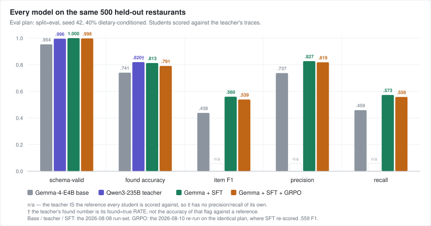
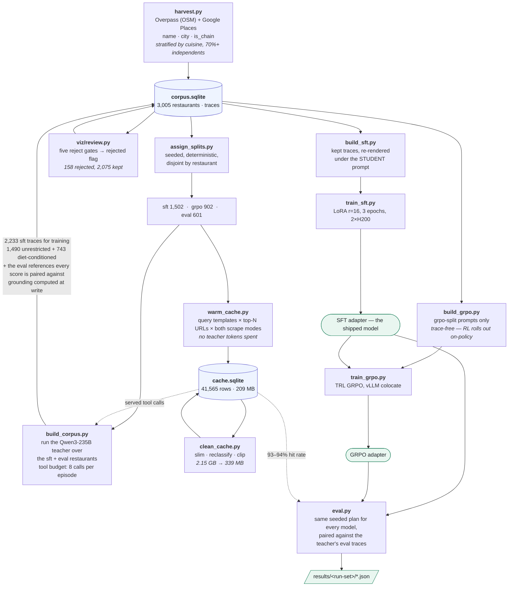
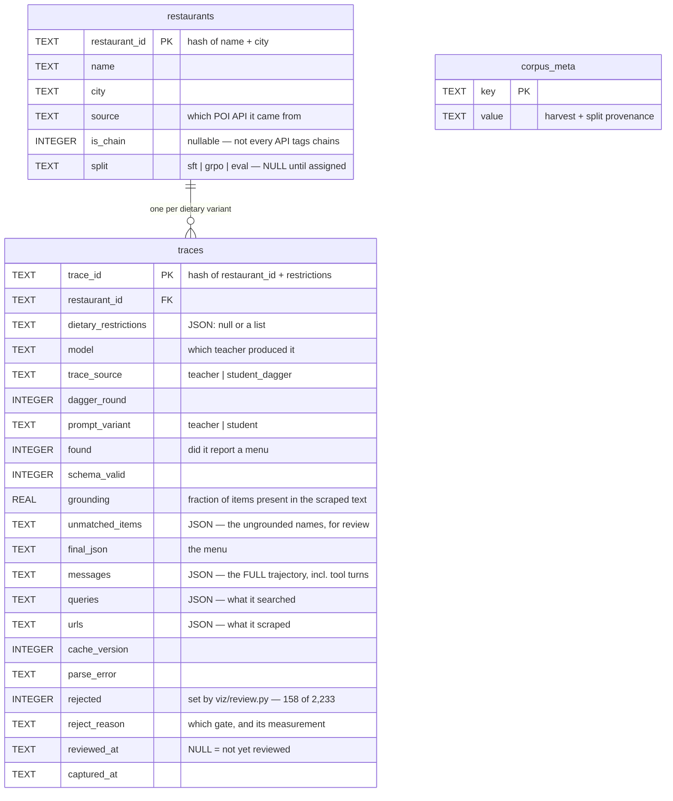
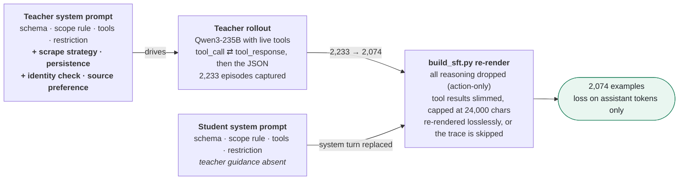
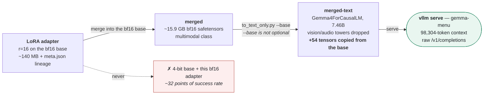
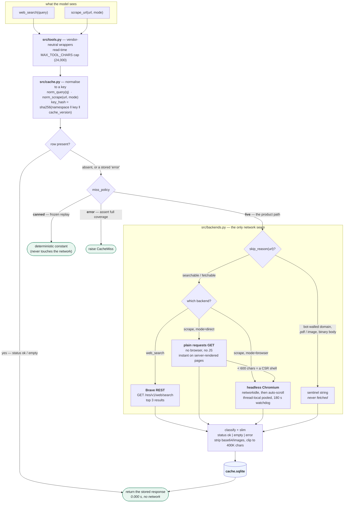
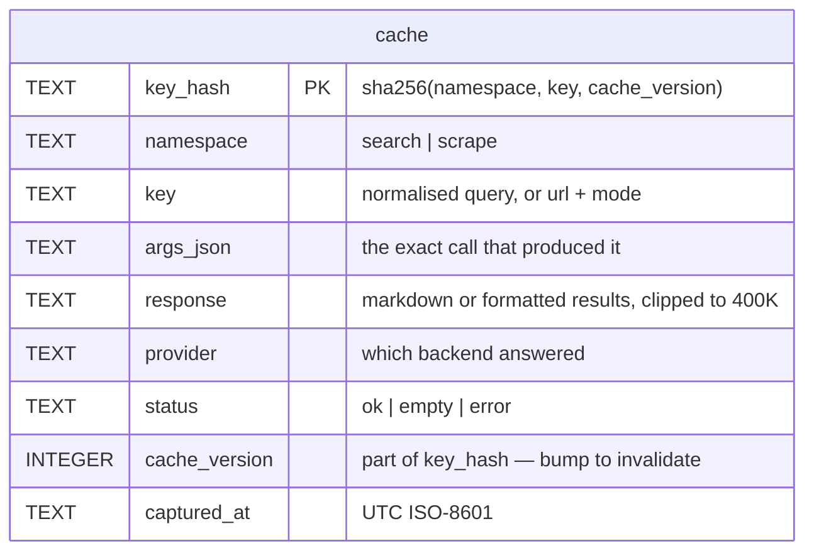

# small-model-finetuning

Fine-tune a small open-weight LLM (`google/gemma-4-E4B-it` — ~8B total, ~4B-effective text path) to take a **restaurant name** as input and return its **menu as structured JSON**, using **web search and scraping as inference-time tools**. The model doesn't memorize menus — it learns to *drive the tools* (search → scrape → extract) and emit the schema in [src/schema.py](src/schema.py).

The teacher is a self-hosted `Qwen/Qwen3-235B-A22B-Instruct-2507-FP8`; the student is Gemma-4-E4B-it, distilled from the teacher's trajectories under a **leaner prompt than the teacher saw** (context distillation), then scored against the teacher's own traces.

**This project is complete.** All five phases ran, everything is measured, and the results are below. The engineering notes and the hard-won constraints behind each design choice live in [CLAUDE.md](CLAUDE.md); the narrative log of every run is [notes/experiments.md](notes/experiments.md).

---

## Results

500 held-out restaurants, one seeded plan (`--split eval --seed 42 --conditioned-frac 0.4`, 40% carrying a dietary restriction), every model on the same episodes with the same tool cache. Students are scored **paired** against the teacher's traces; the teacher is self-reported by construction (it *is* the reference).

| model | schema-valid | found acc | item F1 | precision | recall |
|---|---|---|---|---|---|
| Gemma-4-E4B base | 95.4% | 74.1% | 0.438 | 0.737 | 0.459 |
| **+ SFT — the shipped model** | **100.0%** | **81.3%** | **0.560** | **0.827** | **0.573** |
| + GRPO (50 steps on top of SFT) | 99.8% | 79.1% | 0.539 | 0.819 | 0.558 |
| Qwen3-235B teacher | 99.6% | 82.0% | — | — | — |



**SFT is the result.** +0.12 item F1 and +9 points of precision over the untrained base, schema-validity 95.4% → 100%, and — the sharpest gain — **calibration**: false-finds (claiming a menu for a restaurant that has none) drop 29 → 10. On *finding* the menu at all the 8B student essentially matches the 235B teacher (81.3% vs 82.0%) while running 2.2× faster. What it has not closed is **completeness**: precision 0.827 against recall 0.573 — when it answers it is right, it just returns a partial menu. That gap is what GRPO was supposed to fix.

**GRPO did not fix it.** Two runs, the second with the learning rate corrected (‖B‖ moved 13× further than run 1 in half the steps), produced a policy statistically indistinguishable from the SFT student — 71 wins / 75 losses per episode, all |t| < 1.96. The held-out probe stayed flat while `clipped_ratio` fell 0.32 → 0.20: the policy learned to *finish inside its budget*, not to build better menus. The standing diagnosis is the reward, not the optimizer — the grounding term pays for faithfulness to scraped evidence, which is maximized by reporting **fewer** items, while the real gap is recall. Training was called off there rather than scaled up. Full post-mortem in [notes/experiments.md](notes/experiments.md).

Machine-readable reports (per-model JSON plus the generated table) are committed under [results/](results/); per-episode candidate traces are archived to S3. The chart is generated from those reports — `uv run python scripts/analysis/make_charts.py` — so it cannot drift from them.

| phase | what it produced |
|---|---|
| 1. Agentic tool-call loop | `web_search` + `scrape_url` driving Gemma-4 through the Gemma-4 tool wire format |
| 2. Tool caching + teacher corpus | 2,233 teacher traces and a content-addressed SQLite cache of every fetch |
| 3. SFT distillation | the shipped LoRA adapter — r=16, α=32, lr 2e-4, 3 epochs, ~35M trainable params |
| 4. GRPO RL | trace-free RL on a teacher-free reward — measured, null, stopped |
| 5. Eval | two scored run-sets, paired against the teacher's references |

Every stage after phase 1 runs on rented RunPod GPUs, driven by the phased bootstrap scripts in [scripts/infra/](scripts/infra/) ([eval_pod.sh](scripts/infra/eval_pod.sh), [grpo_pod.sh](scripts/infra/grpo_pod.sh)) — each is idempotent phase-by-phase and documented in its own header.

---

## 01 · Data — collecting and cleaning the corpus

None of this is a downloaded dataset. The restaurants come from public map data, the labels are a much larger model's own agentic trajectories, and the web pages those trajectories read are captured as they are fetched — so any run can later be replayed against the same bytes. Two SQLite files are the only durable state; every box below is a script under [scripts/](scripts/).



The ordering constraint that matters: **`warm_cache` runs before `build_corpus`**, and the teacher runs before any student. The warm pre-pays the *student's* exploration distribution — not just the path the teacher happened to take — which is what makes a frozen, network-free evaluation possible at all. The teacher's eval pass is what *creates* the reference traces every later score is measured against.

### The five reject gates

Cleaning is mechanical rather than hand review. Each gate writes its reason into the trace row, so the cut is auditable after the fact:

| gate | what it drops | count |
|---|---|---|
| A | a found menu with fewer than 4 items — a scrape that half-worked | 58 |
| B | the diet-conditioned sibling of a trace A already rejected | 27 |
| C | grounding below 40% — items that don't appear in the text the agent scraped | 21 |
| D | output that doesn't validate against `MENU_SCHEMA` | 3 |
| E | a menu lifted off an aggregator (allmenus, Yelp, DoorDash) rather than the restaurant | 49 |

**2,233 traces → 2,075 kept → 2,074 training examples** (1,662 found, 412 deliberate not-founds). Grounding is the gate that earns its keep: every extracted item is matched back against the text the agent actually scraped during that episode, so a trace under 40% grounded is a trace that invented food, and it leaves. What survives averages **0.98**.

### The corpus database

`data/corpus.sqlite` is the single source of truth for the data layer: the restaurants, their split, every teacher trajectory, its grounding score, and the review verdict — one file, three tables. v1 spread this across `restaurants.jsonl`, `splits.json`, `traces/*.json`, `reject_list.txt` and `grounding.json`, and they drifted.



`messages` holding the entire trajectory is what makes SFT re-rendering possible: `build_sft.py` replays the teacher's turns under the **student** prompt, so the distillation target is generated once and re-projected as often as the prompt changes.

---

## 02 · Training — context distillation, not prompt copying

The naive version of this stage captures the teacher's trajectories and trains on them verbatim. That bakes in a dependency: the targets are only correct given a prompt full of guidance the student would then also need at inference, so the work has moved into the prompt rather than into the weights.

So the prompt is split in two, by construction, in [src/prompts.py](src/prompts.py):

- **Shared, because it defines what the right menu is** — the schema, the food-only scope rule, the tool declarations, and the diner's dietary restrictions. (The scope rule looks behavioral but decides *which items belong*, so it stays shared. The restriction is a per-episode input; drop it from the student and a filtered-menu target becomes incoherent.)
- **Teacher-only, because it only shapes how the agent works** — try the plain fetch before the browser render, don't give up after one search, confirm the page is the same restaurant, prefer the restaurant's own site over a delivery app.



The behaviour now has to survive in the weights, which is why the dataset is built to show it **contrastively** — a search that returns both a delivery app and the restaurant's own site, with the teacher visibly picking the latter. If it fails to distill, the fix is more contrastive data, not leaking the guidance back into the student prompt.

Loss lands only on tokens the student will itself have to produce; the scraped pages are context, not targets. That mask is computed by hand from the chat template's prefix-preservation property, because Gemma 4 ships no generation markers and the training library's own assistant-only flag is therefore a **silent no-op** — it returns an all-zero mask and trains on nothing.

| knob | value | why it is that value |
|---|---|---|
| adapter | LoRA r=16, α=32, dropout 0.05 | attention + MLP projections; ~35M trainable params |
| base precision | bf16, never 4-bit | a bf16-trained adapter on a 4-bit base cost ~32 points of success rate |
| schedule | 3 epochs, lr 2e-4, cosine | effective batch 16 — 1 per device × 8 accumulation × 2 GPUs |
| hardware | 2 × H200, DDP | gradient checkpointing on, packing off (varlen packing needs an attention kernel this model can't use) |
| over-long examples | dropped, never truncated | right-truncation would cut off the JSON that is the entire target |

> **The failure this fixed was termination, not menu quality.** The v1 student's dominant error was emitting nothing at all — it would gather evidence and never commit to an answer. Its menus were already teacher-quality *when it finished*. A single prompt rule forbidding the empty reply moved success 56% → 88% and empty output 38% → 12% on the same episodes: 16 episodes fixed, none regressed. Diagnosing that before reaching for more training saved the budget that would have gone into it.

---

## 03 · Weights — from adapter to something servable

A trained adapter is not yet a served model. The two conversions between them are both easy to skip, and both fail in ways worth knowing about in advance.



- **Text-only rebuild.** Training writes model and tokenizer but no `preprocessor_config.json`, so vLLM sees the multimodal class, reaches for `AutoProcessor`, and dies. There is no image or audio input here anyway, so [scripts/train/to_text_only.py](scripts/train/to_text_only.py) rebuilds the checkpoint as a text-only causal model.
- **The 54 missing tensors.** Gemma-4 E4B shares keys and values across its last 18 layers, so transformers never builds `k_norm`/`k_proj`/`v_proj` for layers 24–41 and silently drops them (2130 → 2076). Invisible under transformers and harmless to HF eval; vLLM builds a fused projection for every layer and refuses to start. `--base` copies them back in raw. The script's own *"0 missing, 0 unexpected"* report is a **false all-clear** — it proves transformers' expectations were met, not that the checkpoint is complete.

---

## 04 · Inference — one request, and where the cache sits

At inference the model is an agent on a budget: eight tool calls, then it has to answer with whatever it has gathered. A partial menu beats an empty reply, and it also makes better training data than a refusal.

The model only ever sees two generically-named tools, so no vendor name leaks into the data its tool calls get baked into. Everything below [src/tools.py](src/tools.py) — the cache, the provider, the fetch strategy — is invisible to it. A call is a **cache read first**; the network is reached only on a miss, and only when the policy allows it. The position of the cache is the design: it wraps the network backends **inside** the character cap, so what gets stored is the full slimmed page while the cap stays a read-time knob that can be retuned without re-scraping anything.



Three details carry most of the weight:

- **`status` is three-valued, and `empty` is not a failure.** A bot-walled domain returns a sentinel deliberately shorter than `MIN_CONTENT_CHARS`, so it classifies as `empty` — a **permanent** cached negative. An `error` row is a live-policy miss that gets re-fetched next pass; storing dead ends as `error` would re-pay a 30–45 s bot-wall timeout on every single run.
- **`cache_version` is part of the hash.** Bump it when the stored response *shape* changes and the whole cache invalidates cleanly, with no delete step.
- **The miss policy is what makes one code path serve three jobs**: `live` for corpus building and the product, `canned` for reproducible GRPO rollouts, `error` to assert a split is fully warmed before spending GPU time.

What's in the store as shipped — 41,565 rows, 209 MB:

| namespace | status | rows |
|---|---|---|
| scrape | ok | 18,075 |
| scrape | empty | 11,662 |
| scrape | error | 1,110 |
| search | ok | 10,718 |

split by render mode, 16,663 `direct` and 14,184 `browser`.



**Serving the student.** The Gemma student goes through raw `/v1/completions` with *our* chat template and *our* parser, never vLLM's chat/tools path: vLLM ships no Gemma-4 tool-call parser, and re-templating through a chat endpoint would drift from the exact wire format the model was fine-tuned on. Each turn re-renders the prompt from the whole message list, which is only safe because Gemma 4's template is token-prefix-preserving for this shape of trajectory — rendering the first *k* messages is an exact prefix of rendering *k+1*. That property is what lets the training mask be computed by hand, and it is also why a parse failure is fed back as a synthesized tool response rather than a new user turn: a mid-episode user message rewrites earlier tokens and breaks the prefix.

---

## 05 · The output contract

One file defines the menu shape, and the prompt, the validator, the grounding scorer and the RL reward all import it, so they cannot drift apart. It is deliberately small — two levels of nesting, three fields on an item. [src/schema.py](src/schema.py) holds both representations: `SCHEMA_SNIPPET`, the human-readable block shown to the model, and `MENU_SCHEMA`, the machine-checkable mirror.

```jsonc
{
  "found": true,                      // required
  "restaurant_name": "string",        // required
  "cuisine": "string | null",
  "menu": [                           // required
    {
      "section": "string",            // required
      "items": [
        {
          "name": "string",           // required
          "description": "string | null",
          "price": "number | null"    // null = the menu lists none; never a guess
        }
      ]
    }
  ],
  "source_url": "string | null"
}
```

`price: null` means the menu itself lists no price. The model is told never to guess one, so null reads unambiguously as unknown rather than as a missing extraction.

The `found` field has **three distinguishable outcomes**, and keeping the last two apart is the point:

| outcome | meaning |
|---|---|
| `found: true`, `menu: [ … ]` | the normal result — every priced item that belongs on a food menu, in the sections the restaurant itself uses |
| `found: true`, `menu: []` | a menu was found, and the diner's dietary restriction removed every item on it |
| `found: false`, `menu: []`, `notes: "…"` | no page anywhere had this restaurant's menu, and `notes` records what was tried |

Collapsing the last two would make abstention unscoreable. Keeping them machine-distinguishable is what lets found-false traces stay in the training set as deliberate anti-hallucination signal — capped at a fifth of the corpus, so abstention is never inflated into the model's default.

---

## Layout

```
src/                     shared, model-agnostic modules
  schema.py              the menu JSON contract (single source of truth)
  prompts.py             system prompts (teacher/student variants)
  tools.py, backends.py  web_search (Brave) + scrape_url (local Chromium)
  cache.py               content-addressed SQLite tool-call cache
  corpus.py              data/corpus.sqlite access (the single data source of truth)
  grounding.py           menu-grounding scorer
  reward.py              the teacher-free GRPO reward (structure / found / grounding)
  eval_metrics.py        paired scoring vs the teacher's reference traces
  episodes.py, run_meta.py
  gemma/                 the fine-tuning target: model.py, agent.py, run_agent.py
  claude/                Claude Sonnet baseline on the same tools/prompts
  serving/               openai_agent.py — vLLM/OpenAI-compatible runner
scripts/
  corpus/                harvest, build_corpus, warm_cache, clean_cache, assign_splits
  datasets/              build_sft, build_grpo (corpus → training jsonl)
  train/                 train_sft, train_grpo, to_text_only
  eval/                  eval.py, summarize.py, dump_reference.py
  analysis/              analyze_queries, analyze_tool_chars, adapter_norms, make_charts
  infra/                 corpus_sync (S3), runpod_create, eval_pod.sh, grpo_pod.sh,
                         serve_teacher.sh, smoke_teacher
results/                 committed eval reports — the permanent record (see results/README.md)
notes/                   plans, the experiment log, and architecture.html (the illustrated writeup)
tests/                   395 tests, no GPU or network required
viz/                     local FastAPI extraction demo + trace-review UI
data/                    git-ignored; source of truth is S3 (see notes/S3_setup.md)
  corpus.sqlite          restaurants + sft/grpo/eval split + traces + grounding + reject flags
  cache.sqlite           tool-call cache
```

## Setup

Package manager is **uv** (never bare `pip`). Examples assume bash.

```bash
uv sync                              # reproduce the env from pyproject.toml + uv.lock
uv run playwright install chromium   # scrape backend
cp .env.example .env                 # then fill in BRAVE_API_KEY, HF_TOKEN, etc.
huggingface-cli login                # google/gemma-4-E4B-it is gated
```

`.env` holds `BRAVE_API_KEY` (search; scrape needs no key), `HF_TOKEN` (gated model), the Claude baseline's `ANTHROPIC_API_KEY`, `WANDB_API_KEY`, and the S3 config (`S3_BUCKET`/`S3_PREFIX`/`AWS_*`). See [.env.example](.env.example).

```bash
uv run pytest                        # 395 tests, ~3 min, no GPU or network
```

## Running the stages

```bash
# One episode through the agentic loop (dev box defaults to 4-bit — see CLAUDE.md)
uv run python main.py

# Claude baseline on the same tools/prompt/schema
uv run python src/claude/run_claude.py

# Sync data artifacts with S3 (corpus, cache, datasets, models)
uv run python scripts/infra/corpus_sync.py pull
uv run python scripts/infra/corpus_sync.py push --only sft

# Build the SFT dataset, then LoRA-train (2×H200 pod — see notes/runpod_sft.md)
uv run python scripts/datasets/build_sft.py
uv run python scripts/train/train_sft.py --dry-run     # cheap gate before GPU
accelerate launch --config_file configs/accelerate_ddp.yaml scripts/train/train_sft.py

# Eval a served checkpoint against the teacher's references
uv run python scripts/eval/eval.py --model gemma --gemma-vllm-base-url http://... \
    --split eval --seed 42 --limit 500 --conditioned-frac 0.4 --json report.json
uv run python scripts/eval/summarize.py results/<run-set> -o results/<run-set>/README.md

# The live extraction demo (port 8000) and the trace-review UI (port 8001)
uv run uvicorn viz.server:app --host 127.0.0.1 --port 8000
uv run uvicorn viz.review:app --host 127.0.0.1 --port 8001
```

Full multi-GPU runs are driven end to end by the pod scripts rather than by hand:

```bash
bash scripts/infra/eval_pod.sh setup   # then serve-teacher, smoke, run-teacher, ...
bash scripts/infra/grpo_pod.sh setup   # then prep-model, smoke, train, ...
```

## If you pick this up again

The cheapest open question is the one GRPO left on the table: **the reward asks for precision and the model needs recall.** Re-weight [src/reward.py](src/reward.py) for menu completeness before spending another GPU-hour on more steps — the run-2 evidence says more of the same reward cannot close the gap. Everything needed to test that is already built and warmed: the `grpo` split's cache is complete (902/902 restaurants), the harness is [scripts/infra/grpo_pod.sh](scripts/infra/grpo_pod.sh), and a 50-step run is a few hundred dollars.

## Hardware note

The dev box is a single 24 GB GPU with limited host RAM, so `main.py` defaults to 4-bit loading and the code pins `sdpa` attention (FlashAttention cannot serve Gemma-4's `head_dim=512` global layers, on any GPU). Real training and serving happen on rented multi-GPU pods, where the binding constraints are entirely different — vLLM handles `head_dim=512` natively and needs none of the HF-path workarounds. Both sets of constraints, and why they differ, are documented in [CLAUDE.md](CLAUDE.md).
